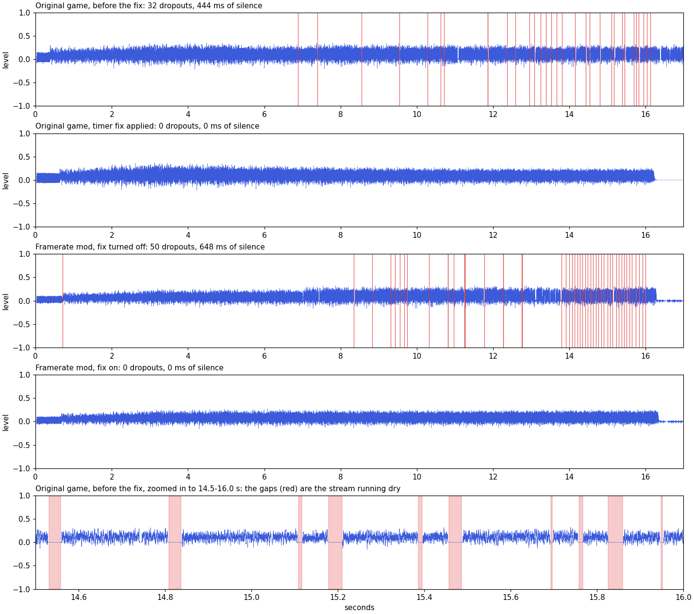

# Music cutting out at high pitch (Windows timer resolution)

**Short version:** on current Windows 10 and 11, the original Undertale (v1.08, Steam) cuts in and
out whenever it plays music at a high pitch, most noticeably during the rising sound just before
Asriel's fight on the True Pacifist route. The cause is how Windows has handled sleep timing since
2020, combined with how the GameMaker runner streams music. The framerate mod fixes it.



*The same 16-second sound recorded straight from the game's audio output. Red lines are dropouts
(stretches of silence). The bottom panel zooms in on the original game near the end of the sound.*

## Symptoms

- When Flowey takes the human SOULs and turns into Asriel, the screen fades to white while a noise
  rises in pitch. In the unmodded game that noise clips and stutters, more and more as it rises.
- It happens on unmodded v1.08 with default settings. It isn't a sound driver problem: changing
  drivers doesn't help (see this
  [Reddit thread](https://www.reddit.com/r/Undertale/comments/zz6dwa/how_to_fix_this_sound_durning_flowey/),
  whose waveform matches ours).
- Videos of the same scene recorded years ago sound clean. They were recorded before the Windows
  change described below, or on PCs where another program happened to fix the timing for the game.
- The frame rate and game speed stay normal. Only the sound breaks up.

## Cause

### How the runner streams music

Undertale's music files (`mus_*.ogg` in the game folder) are streamed: the GameMaker 1.4 runner
decodes them a piece at a time on a background thread and feeds the pieces to the audio library
(OpenAL). That thread runs a loop: refill every playing stream, then sleep for whatever is left of
16 ms (`Sleep(16 - time spent)`). In the Steam v1.08 `UNDERTALE.exe` the loop is the function at
`0x4850e0`.

A sound played at pitch 3 uses up its data three times as fast, so the thread has to keep up with
three times as much audio.

### What changed in Windows

Windows only wakes sleeping threads on a timer tick, which is 15.6 ms by default. `Sleep(16)`
therefore lasts until the second tick: about **31 ms instead of 16**. Programs that need precise
timing (games, browsers, audio players) ask for 1 ms ticks with `timeBeginPeriod(1)`.

- **Before Windows 10 version 2004 (May 2020)** that request was global. If any program on the PC
  asked for 1 ms (a browser playing video, Discord, a music player), every program got precise
  sleeps, so the game usually worked without ever asking.
- **Since version 2004** the request only applies to the program that makes it. The GameMaker 1.4
  runner never makes it, so its streaming thread now wakes about every 31 ms. That halves how
  often streams are refilled. At normal pitch there is still enough slack. From about 1.8 times
  normal pitch the stream runs dry between refills, and each time it does there is a gap of
  silence, mostly 10 to 25 ms long (up to about 40). The higher the pitch, the more gaps.

### Where it happens in the game

Any streamed sound played well above normal pitch. Searching the game's code for pitch changes on
streamed files finds these (only the first one has been recorded; the scene names for the others
come from the object names and code, so treat them as likely rather than confirmed):

| Scene (likely) | Object | Sound | Pitch |
|---|---|---|---|
| Flowey becomes Asriel, True Pacifist (recorded) | `obj_friendscene` | `f_destroyed3.ogg` | rises 0.8 to about 4 |
| The white fade at the end of the Omega Flowey fight | `obj_flowey_master` | `f_destroyed3.ogg` | rises 1 to 3 |
| A Mettaton scene | `obj_mettatonb_third` | `computer.ogg` | rises 0.8 to 2.8 |
| Dying in the Omega Flowey fight | `obj_vsflowey_heartdefeated` | `gameover.ogg`, three copies | 2.64, 2.81 and 3 |
| A Mettaton boss event | `obj_mettboss_event` | `f_destroyed2.ogg` | rises to about 2 |
| Monster Kid and Undyne, genocide route | `obj_mkid_battle` | `f_destroyed2.ogg` | rises from 0.5 |
| True Lab elevator | `obj_labelevator_a` | `f_destroyed3.ogg` | rises from 1.4 |
| A beam attack in the Asriel fight | `obj_lastbeam` | `sfx_rainbowbeam_hold.ogg` | 1.8 |

Most sound effects (`snd_*`) are stored inside `data.win` rather than streamed, so they aren't
affected. Sounds played at normal pitch or slowed down aren't affected either.

### The same cause elsewhere: the frame limiter

The runner's frame limiter also sleeps. With Undertale's shipped settings it times frames to the
monitor's refresh instead (`AlternateSyncMethod=1` in `options.ini`), so the game runs at its
normal 30 frames per second. With `AlternateSyncMethod=0` it uses `Sleep`, and on current Windows
the unmodded game runs at **23.4 frames per second instead of 30**: the whole game plays at about
78% speed. The framerate mod uses its own frame limiter, so it isn't affected.

## Measurements

Recorded on Windows 11 (build 26200) from the game process alone (Windows process loopback
capture), using the F7 sound test described below, which plays the Asriel transition's sound with
the scene's exact pitch and volume steps. A dropout is a stretch of at least 2 ms below -50 dB
within the 16 seconds of the sound.

| | Without the fix | With the fix |
|---|---|---|
| Original game, shipped settings | 44 dropouts, 543 ms of silence | |
| Original game, `AlternateSyncMethod=0` | 32 dropouts, 444 ms of silence | 0 |
| Framerate mod | 50 dropouts, 648 ms of silence | 0 |

Frame rate of the unmodded game's own limiter, over 300 frames:

| Target | `AlternateSyncMethod` | Without the fix | With the fix |
|---|---|---|---|
| 30 (the game's speed) | 1 (shipped) | 29.9 | 30.0 |
| 30 | 0 | 23.4 | 29.9 |
| 75 | 0 | 64.6 | 75.3 |

## The fix

The mod calls `timeBeginPeriod(1)` once at startup, like most games do. Every sleep in the runner
then lasts as long as it asks for: the streaming thread refills every 16 ms again and the music
keeps playing at any pitch the game uses.

Making that call from GameMaker 1.4 isn't straightforward:

- **GML can only call DLL functions through `external_define`/`external_call`**, and in this
  runner `external_define` ignores the calling convention it's given. A function found under its
  plain exported name is always called as cdecl, where the caller removes the arguments
  afterwards; stdcall is only used for names decorated like `_Name@8`, which Windows' own DLLs
  don't use. Windows API functions are stdcall, where the function removes its arguments itself.
  With both doing it, the stack ends up wrong and the game crashes. Only functions with no
  arguments, or real cdecl functions (the C runtime in `msvcrt.dll`), can be called safely.
- **`_beginthread` from the C runtime is cdecl** and starts a thread on any function that takes
  one argument. `timeBeginPeriod` takes exactly one. So the mod starts a thread on
  `timeBeginPeriod` with the argument 1. The thread finishes right away, and the 1 ms request
  belongs to the whole process, so it stays in effect.
- **That needs `timeBeginPeriod`'s address.** `UNDERTALE.exe` has no address randomization (it
  always loads at `0x400000`), so the slot in its import table that holds `timeGetTime`'s address
  is always at `0x6d842c`. `timeGetTime` and `timeBeginPeriod` live in the same Windows DLL. The
  mod reads that address, walks back to the start of the DLL and looks up `timeBeginPeriod` in
  the DLL's export table. Memory is read with the C runtime's `memcpy` into a GML string.
- **GML numbers are doubles**, and `external_call` passes them to the function as 8 raw bytes. To
  pass two 32-bit values (an address, a length) the mod builds the double whose bits are exactly
  those values: `k * power(2, -1074)` is the double whose 64 bits are the integer `k`.

Safety checks: it only runs on the Steam v1.08 `UNDERTALE.exe` (checked by the build timestamp in
its header, `0x596f3367`). It skips Wine and Proton, where sleeps are already precise. And it gives
up without doing anything if any step doesn't find what it expects. The code is `__fl_timerfix` in
[`mod/gml/runtime.gml`](../mod/gml/runtime.gml). To turn it off, add `timerfix=0` to
`UndertaleFramerate.ini` in the game folder.

## Testing it yourself

With the mod installed, add these lines to `UndertaleFramerate.ini` in the game folder:

```
testsound=1
cmdhook=1
```

- `testsound=1`: press **F7** anywhere (the title screen works) to play the Asriel transition's
  sound with the scene's pitch and volume steps, and F7 again to stop it. With `timerfix=0` added
  you can hear the original bug; without it, the fixed sound.
- `cmdhook=1`: a script can control the game by writing commands to `fl_cmd.txt` in the save
  folder (`%LOCALAPPDATA%\UNDERTALE`); replies go to `fl_cmd_out.txt`. `report` shows whether the
  fix is on, and `sound` plays the same test sound. The full list is in the
  [developer notes](../mod/README.md).
